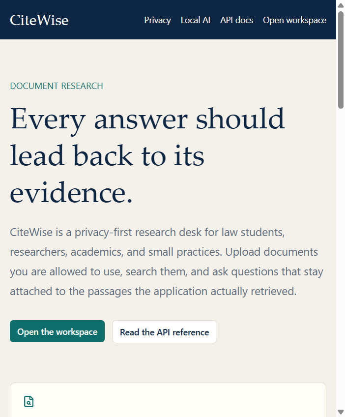
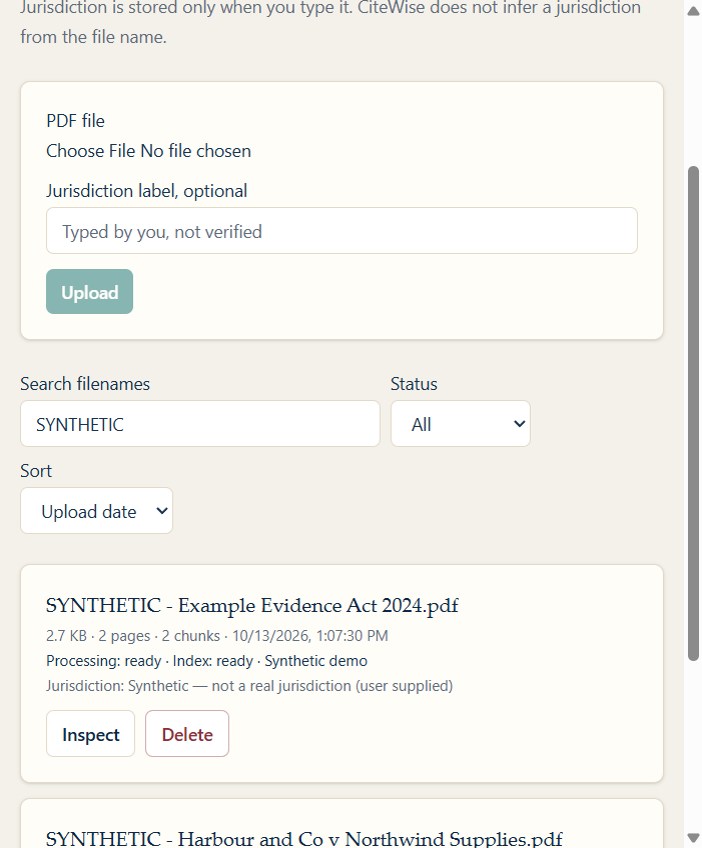
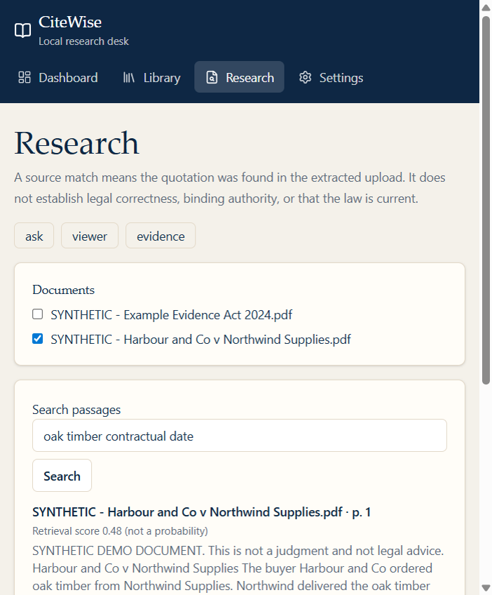
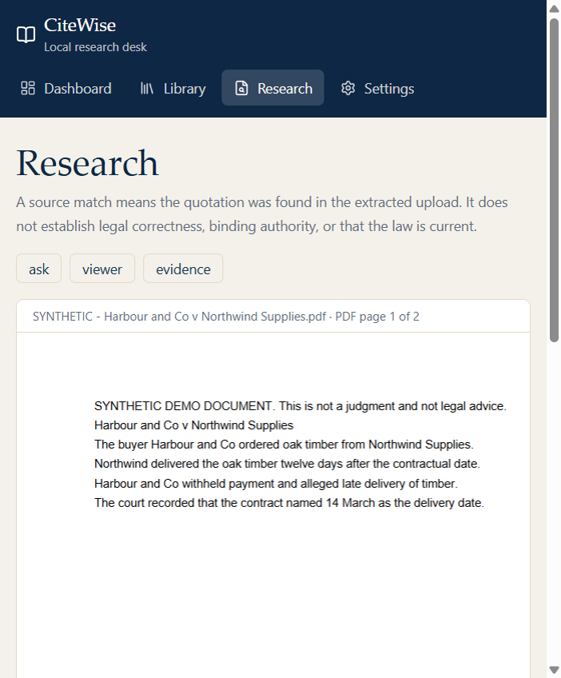
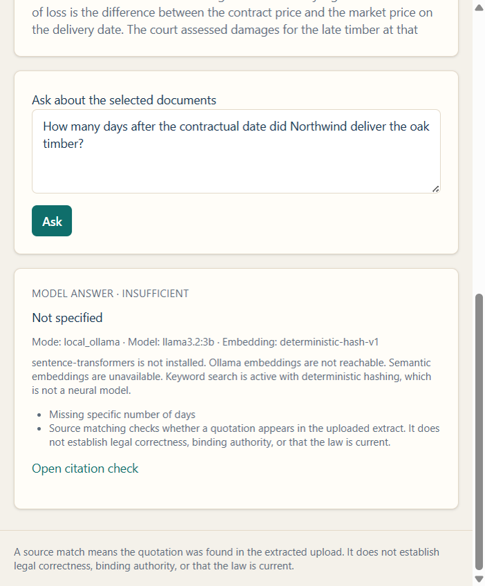
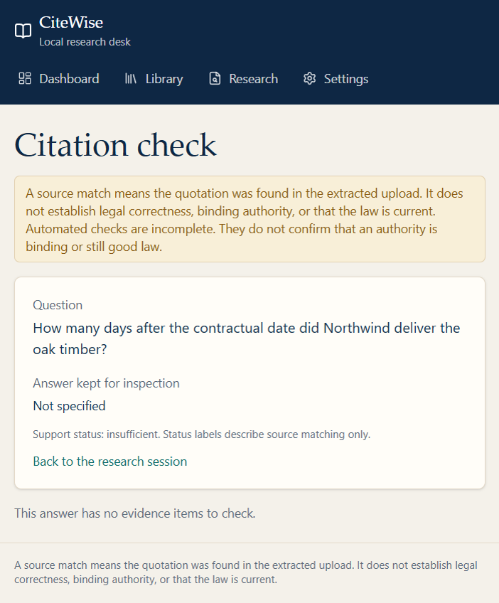
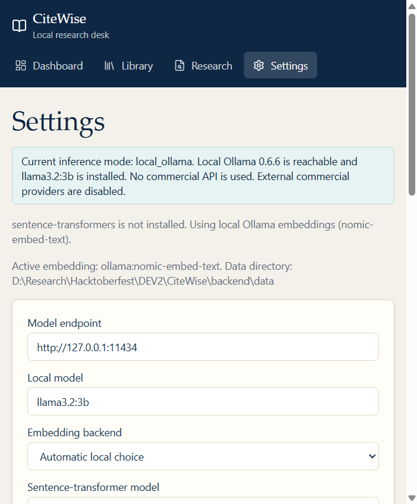
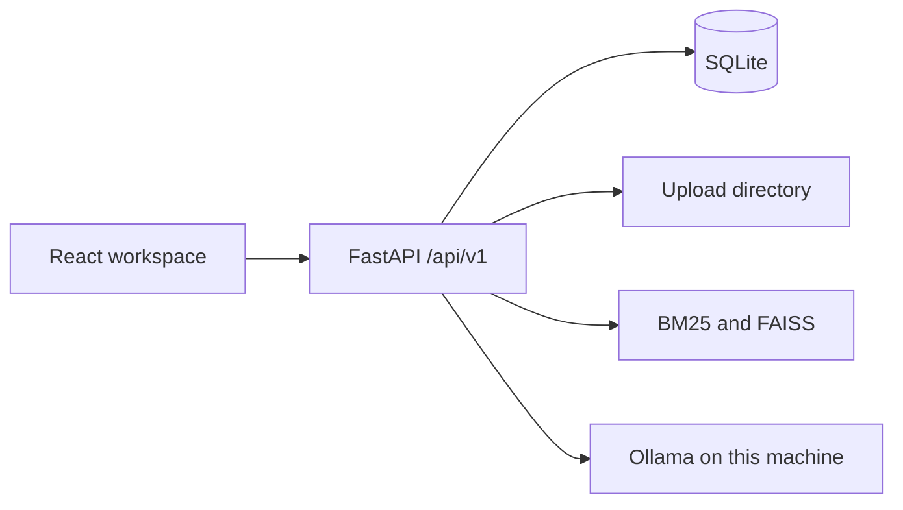

# CiteWise

Every answer should lead back to its evidence.

CiteWise is a privacy-first research desk for people working with documents they already have: law students, legal researchers, academics, and small practices. You upload PDFs, search the extracted text, and ask questions. Answers are supposed to point at the passage they came from. If the documents do not support an answer, the application should say so.

It is a document research assistant. It is not a lawyer, and it is not a database of legal authorities.

## The problem

General chat tools answer smoothly even when the source is missing, and they often invent a citation that looks plausible. A reader then has to reconstruct whether a quotation, a page number, or a case name was ever in the file. CiteWise keeps the upload, the page, the chunk, and the quotation check next to the answer so a failure is visible.

## Features

- Upload PDFs, with checks for type, signature, size, and page count.
- Extract every page. Empty and scanned pages stay in the page list and are described as having no extractable text. OCR is not included.
- Search with BM25 and a local vector index (FAISS). Semantic vectors come from sentence-transformers when that extra is installed, otherwise from a local Ollama embedding model, otherwise from deterministic hashing that the interface names as such.
- Ask a question through Ollama. There is no commercial model API in this release.
- Check that a cited chunk exists, that the page exists, that the chunk was supplied to the model, and that the quotation matches the extract after normalisation.
- Keep research sessions on the local database and export a Markdown report.
- Show the model and retrieval settings used for each answer.

## Screenshots

Captured on 16 October 2026 from a local run. The documents in these pictures are the synthetic demo set. They are not real cases.















Notes for each image are in [docs/screenshots/README.md](docs/screenshots/README.md). The settings image includes this machine's local data directory path.

## Architecture



Uploaded text is passed to the model as untrusted evidence, not as system instructions. The model has no shell and no tool that can open the network because a passage asked it to.

## Technology

- Frontend: React 19, TypeScript, Vite, Tailwind CSS, React Router, TanStack Query, React Hook Form, Zod, pdf.js via react-pdf.
- Backend: Python 3.12, FastAPI, Pydantic, SQLAlchemy, Alembic, SQLite, PyMuPDF, rank-bm25, FAISS CPU, optional sentence-transformers.
- Models: Ollama. The default chat tag is `llama3.2:3b`.

Direct dependency versions are pinned in `backend/pyproject.toml` and `frontend/package.json` from the package registries at the time of this release.

## Requirements

- Python 3.12
- Node.js 22
- Optional: [Ollama](https://ollama.com) and a local model
- Optional: Docker, without a GPU

Ollama's own library listing reports `llama3.2:3b` at about 2.0 GB and `nomic-embed-text` at about 274 MB. Those figures are weight sizes, not a speed or cost measurement. A 3B model on CPU is usable on a machine with 8 GB of memory and more comfortable with 16 GB, because the browser, the index, and the operating system need memory too. A GPU is not required.

`sentence-transformers/all-MiniLM-L6-v2` is a small CPU embedding model. Installing it also installs PyTorch, which is large, so it is an optional extra rather than part of the default install. Choosing that backend can download the public model weights once. Your documents are not part of that download. Confirm the current size on the model card before you install it.

## Installation

From the repository root:

```bash
cd backend
python -m venv .venv
```

Windows:

```powershell
.\.venv\Scripts\activate
pip install -e ".[dev]"
```

macOS or Linux:

```bash
source .venv/bin/activate
pip install -e ".[dev]"
```

Optional semantic model:

```bash
pip install -e ".[semantic]"
```

Frontend:

```bash
cd frontend
npm install
```

Copy `.env.example` to `.env` if you want to change ports, paths, or the model name. The defaults are local and do not contain secrets.

## Run

Backend, from `backend` with the virtual environment active:

```bash
python -m uvicorn app.main:app --reload --host 127.0.0.1 --port 8000
```

Frontend, from `frontend`:

```bash
npm run dev
```

Open `http://127.0.0.1:5173`. The API reference is `http://127.0.0.1:8000/docs`.

Docker Compose, CPU only, using Ollama on the host if it is running:

```bash
docker compose up --build
```

## Local model

Install Ollama, then:

```bash
ollama pull llama3.2:3b
ollama pull nomic-embed-text
```

CiteWise talks to `http://127.0.0.1:11434` unless you change `CITEWISE_OLLAMA_BASE_URL`. Settings can list models, change the selected tag, and run a connectivity check. If Ollama is down, search still works and question answering returns the retrieved passages with an explicit unavailable status. The application does not switch to another vendor.

### Model licences

The CiteWise application code in this repository is under the MIT licence. Model weights are not included, and an open-weight model is not automatically OSI-approved open source.

- Llama 3.2 is published by Meta under the Llama 3.2 Community License. Read that licence before you download the weights. It is not the MIT licence.
- `nomic-embed-text` and `sentence-transformers/all-MiniLM-L6-v2` have been distributed under the Apache Licence 2.0. Confirm the tag you actually pull; model pages change.

## Configuration

Environment variables use the `CITEWISE_` prefix. See `.env.example`.

| Setting | Role |
| --- | --- |
| `CITEWISE_DATA_DIR` | Uploads, SQLite file, and indexes |
| `CITEWISE_OLLAMA_BASE_URL` | Local model endpoint |
| `CITEWISE_OLLAMA_MODEL` | Chat model tag |
| `CITEWISE_EMBEDDING_BACKEND` | `auto`, `sentence-transformers`, `ollama`, or `hash` |
| `CITEWISE_CHUNK_SIZE` | Whitespace-token window, default 700 |
| `CITEWISE_CHUNK_OVERLAP` | Overlap, default 100 |
| `CITEWISE_TOP_K` | Passages sent to the model |
| `CITEWISE_SCORE_THRESHOLD` | Fused retrieval score, not a probability |
| `CITEWISE_MAX_UPLOAD_MB` | Upload limit, default 25 |
| `CITEWISE_MAX_PAGES` | Page limit, default 200 |

The Settings screen can change the stored copy of these values. Chunk or embedding changes need **Rebuild indexes** before the next search. Retention, when set, deletes older documents only when you apply it. Leaving it blank keeps documents until you delete them.

`local_processing_only` cannot be turned off. There is no API-key setting.

## Example workflow

1. Start the API and the web app.
2. Upload a PDF, or run `python -m app.cli seed-demo` from `backend`.
3. Search for a phrase you can see in the file.
4. Ask a question about the selected document.
5. Open the evidence card and the PDF page.
6. Export the session report.
7. Ask something the file does not cover and read the insufficient-evidence result.

The click-by-click version is [docs/demo-script.md](docs/demo-script.md).

## Database migrations

The API runs `alembic upgrade head` when it starts. You can also run it yourself from `backend`:

```bash
alembic upgrade head
```

The first migration creates documents, pages, chunks, sessions, turns, and settings.

Rebuild the indexes after a chunking change:

```bash
python -m app.cli rebuild-index
```

## Privacy

Documents, extracts, embeddings, and sessions stay in the data directory you configure. Logs record ids and status, not page text. There is no telemetry. Queries go to the configured local endpoint only.

That does not secure the computer, the Ollama port, or any backup of the data directory. Do not put this process on an open network. This release has no user accounts. If you need network access, add authentication and access control before anyone else can reach the documents.

## Security limitations

- Prompt injection in an uploaded PDF can still influence a model that does not follow the system prompt. CiteWise separates instructions from evidence and rejects citations that do not resolve. That is not perfect prevention.
- Quotation matching is a text check. It does not decide that a legal statement is true, binding, or current.
- Encrypted PDFs are rejected. Scanned PDFs are not OCR'd.
- Jurisdiction is stored only when a person types it. A filename is never treated as a verified jurisdiction.

More detail is in [SECURITY.md](SECURITY.md).

## API

Interactive schemas are generated by FastAPI at `/docs`.

| Method | Path | Purpose |
| --- | --- | --- |
| GET | `/api/v1/health` | Process, database, and local model status |
| GET | `/api/v1/models` | Models reported by Ollama |
| POST | `/api/v1/models/check` | Connectivity check for an endpoint and tag |
| GET, PUT | `/api/v1/settings` | Retrieval, privacy, and model settings |
| POST | `/api/v1/settings/apply-retention` | Delete documents older than the retention window |
| POST | `/api/v1/documents` | Upload a PDF |
| GET | `/api/v1/documents` | List documents |
| GET | `/api/v1/documents/{id}` | Metadata and page previews |
| GET | `/api/v1/documents/{id}/pages/{n}` | Extracted page text |
| GET | `/api/v1/documents/{id}/file` | Original PDF |
| DELETE | `/api/v1/documents/{id}` | Delete the file and derived rows |
| POST | `/api/v1/documents/{id}/reindex` | Extract and index again |
| POST | `/api/v1/documents/demo/seed` | Load synthetic demo PDFs |
| POST | `/api/v1/search` | Retrieve passages without calling the chat model |
| POST | `/api/v1/answers` | Retrieve, then ask the local model |
| GET, POST | `/api/v1/sessions` | Research sessions |
| GET | `/api/v1/sessions/{id}` | Session and turns |
| GET | `/api/v1/sessions/{id}/report` | Markdown report |
| GET | `/api/v1/turns/{id}` | One stored answer |
| POST | `/api/v1/verify` | Re-check citations for a turn |
| POST | `/api/v1/indexes/rebuild` | Rebuild BM25 and FAISS from stored chunks |

Validation errors return HTTP 422. Unknown ids return 404. Unsupported uploads return 415. Oversized uploads return 413. A repeated file hash returns 409.

## Testing

From `backend`, after `pip install -e ".[dev]"`:

```bash
ruff check .
pytest
```

From the repository root:

```bash
python scripts/evaluate_retrieval.py
```

The script prints Recall@k, MRR, and nDCG for the synthetic development set. Do not copy those numbers into a paper as a legal benchmark. The set is labelled as a development fixture in `tests/eval_corpus.json`.

Frontend:

```bash
cd frontend
npm test
npm run lint
npm run typecheck
npm run build
```

Default tests do not download a chat model. Optional Ollama coverage:

```bash
cd backend
set CITEWISE_RUN_OLLAMA=1
pytest -m integration
```

On macOS or Linux, use `export CITEWISE_RUN_OLLAMA=1`.

## Troubleshooting

- **Ollama is not reachable.** Start the Ollama application. The health panel should change from unavailable to the local model. Until then, search still returns passages and answers are marked model-unavailable.
- **The selected model is missing.** `ollama pull llama3.2:3b`, then run the connectivity check. A missing tag is reported as `model_missing`, not replaced with another provider.
- **The first semantic search is slow.** Loading an embedding model or calling Ollama to embed the library takes time. The hashing backend is immediate and is labelled as not semantic.
- **A PDF shows no text.** It may be scanned. Pages are retained. OCR is not implemented, so those pages cannot be searched.
- **A PDF is rejected.** It may be encrypted, truncated, over the page limit, or not a PDF despite the extension.
- **Page numbers look wrong.** CiteWise uses the PDF page index, starting at 1. A printed page number inside the document can differ. The viewer opens the PDF page index.
- **Docker cannot see Ollama.** The compose file points at `host.docker.internal:11434`. Ollama must be running on the host. The container does not request a GPU.

## Why open innovation matters

Local processing can keep a document on the machine that already holds it, which matters when the file should not be sent to a third-party API. Open-weight models make it possible to swap the generator without rewriting the research workflow, so an experiment can name the exact tag it used. Because the quotation check compares the model output with the extract, a bad citation is something a reader can inspect rather than a fluent sentence with nowhere to go. Running locally can also avoid a per-query invoice from a hosted model. That is not a claim that it is cheaper overall: electricity, hardware, and the time a CPU spends on a 3B model are real costs, and this project has not measured them.

## Roadmap

- Optional OCR for scanned PDFs, clearly separated from born-digital text.
- A real cross-encoder reranker. The current optional rerank is only a lexical overlap adjustment.
- Authentication and access control before any shared deployment.
- Richer evaluation sets, still labelled as evaluations rather than as proof of legal competence.
- Additional local model providers behind the same interface, still off unless configured.

## Contributing

See [CONTRIBUTING.md](CONTRIBUTING.md).

## Licence

Application code: [MIT](LICENSE). Model weights are separate and are not shipped in this repository.
