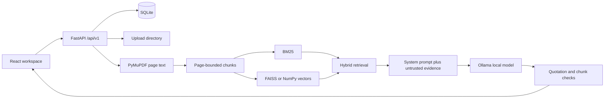

# Architecture

Document text never becomes the system prompt. The model provider implementation is Ollama only. Embeddings prefer sentence-transformers, then a local Ollama embedding model, then a labelled hashed bag-of-words fallback.

SQLite stores documents, pages, chunks, sessions, turns, and settings. The vector index can be rebuilt from the chunk table.
